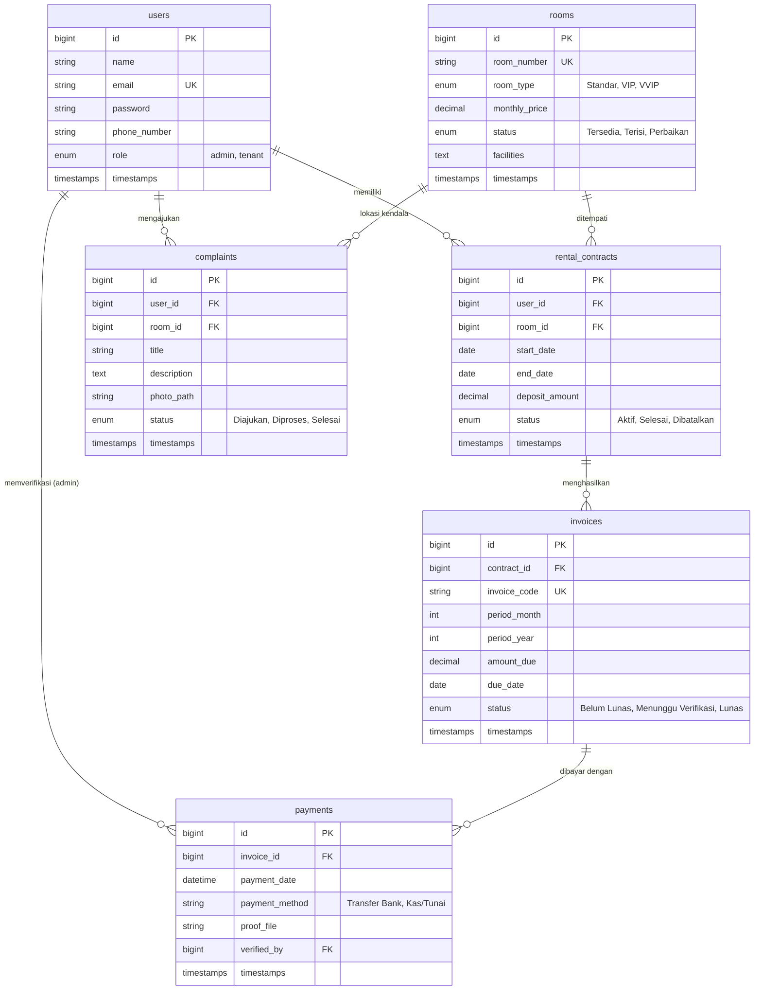

# 🗄️ Dokumentasi Struktur Basis Data — KostPay

Dokumen ini memuat spesifikasi teknis lengkap mengenai skema basis data, rincian kolom, tipe data, *constraint* (batasan), serta relasi antar tabel untuk aplikasi **KostPay (Sistem Informasi Manajemen dan Pembayaran Kost Pondok Khasanah)**.

Dokumen ini menjadi acuan utama bagi **Database Engineer / Tim Pengembang** dalam menyusun file Laravel Migration dan Model Eloquent.

---

## 📌 1. Diagram Relasi Entitas (Entity-Relationship Diagram)



---

## 📋 2. Rincian Kolom & Atribut Tabel

---

### A. Tabel `users`
Menyimpan seluruh kredensial dan identitas pengguna sistem, baik Pemilik Kost (`admin`) maupun Penghuni Kost (`tenant`).

| Nama Kolom | Tipe Data | Constraint / Atribut | Keterangan |
| :--- | :--- | :--- | :--- |
| `id` | `BIGINT UNSIGNED` | Primary Key, Auto Increment | Identifikator unik pengguna |
| `name` | `VARCHAR(255)` | NOT NULL | Nama lengkap pengguna |
| `email` | `VARCHAR(255)` | NOT NULL, UNIQUE | Alamat email aktif untuk login |
| `password` | `VARCHAR(255)` | NOT NULL | Kata sandi terenkripsi (Hash Bcrypt) |
| `phone_number` | `VARCHAR(20)` | NOT NULL | Nomor telepon / WhatsApp aktif |
| `role` | `ENUM('admin', 'tenant')` | NOT NULL, DEFAULT: `'tenant'` | Hak akses / peran dalam sistem |
| `created_at` | `TIMESTAMP` | NULLABLE | Waktu data akun dibuat |
| `updated_at` | `TIMESTAMP` | NULLABLE | Waktu data akun terakhir diperbarui |

*Contoh Schema Migration Laravel:*
```php
Schema::create('users', function (Blueprint $table) {
    $table->id();
    $table->string('name');
    $table->string('email')->unique();
    $table->string('password');
    $table->string('phone_number', 20);
    $table->enum('role', ['admin', 'tenant'])->default('tenant');
    $table->timestamps();
});
```

---

### B. Tabel `rooms`
Menyimpan master data fisik kamar kost, jenis tipe kamar, harga sewa bulanan, fasilitas, serta status ketersediaannya.

| Nama Kolom | Tipe Data | Constraint / Atribut | Keterangan |
| :--- | :--- | :--- | :--- |
| `id` | `BIGINT UNSIGNED` | Primary Key, Auto Increment | Identifikator unik kamar |
| `room_number` | `VARCHAR(10)` | NOT NULL, UNIQUE | Nomor/kode kamar unik (misal: "A01", "B02") |
| `room_type` | `ENUM('Standar', 'VIP', 'VVIP')` | NOT NULL | Kategori / tipe kamar |
| `monthly_price` | `DECIMAL(12, 2)` | NOT NULL | Tarif sewa per bulan (contoh: `1500000.00`) |
| `status` | `ENUM('Tersedia', 'Terisi', 'Perbaikan')` | NOT NULL, DEFAULT: `'Tersedia'` | Status operasional kamar |
| `facilities` | `TEXT` | NULLABLE | Daftar rincian fasilitas (AC, WiFi, Kasur, dll.) |
| `created_at` | `TIMESTAMP` | NULLABLE | Waktu data kamar ditambahkan |
| `updated_at` | `TIMESTAMP` | NULLABLE | Waktu data kamar terakhir diubah |

*Contoh Schema Migration Laravel:*
```php
Schema::create('rooms', function (Blueprint $table) {
    $table->id();
    $table->string('room_number', 10)->unique();
    $table->enum('room_type', ['Standar', 'VIP', 'VVIP']);
    $table->decimal('monthly_price', 12, 2);
    $table->enum('status', ['Tersedia', 'Terisi', 'Perbaikan'])->default('Tersedia');
    $table->text('facilities')->nullable();
    $table->timestamps();
});
```

---

### C. Tabel `rental_contracts`
Menyimpan kontrak sewa yang menghubungkan penghuni (`users`) dengan kamar yang ditempati (`rooms`), beserta durasi sewa dan deposit awal.

| Nama Kolom | Tipe Data | Constraint / Atribut | Keterangan |
| :--- | :--- | :--- | :--- |
| `id` | `BIGINT UNSIGNED` | Primary Key, Auto Increment | Identifikator unik kontrak sewa |
| `user_id` | `BIGINT UNSIGNED` | NOT NULL, Foreign Key (`users.id`) | ID penghuni kost yang menyewa |
| `room_id` | `BIGINT UNSIGNED` | NOT NULL, Foreign Key (`rooms.id`) | ID kamar yang disewa |
| `start_date` | `DATE` | NOT NULL | Tanggal mulai berlaku sewa |
| `end_date` | `DATE` | NOT NULL | Tanggal akhir periode sewa |
| `deposit_amount` | `DECIMAL(12, 2)` | NOT NULL, DEFAULT: `0.00` | Nominal uang jaminan/deposit awal |
| `status` | `ENUM('Aktif', 'Selesai', 'Dibatalkan')` | NOT NULL, DEFAULT: `'Aktif'` | Status keberlangsungan kontrak |
| `created_at` | `TIMESTAMP` | NULLABLE | Waktu kontrak diterbitkan |
| `updated_at` | `TIMESTAMP` | NULLABLE | Waktu status kontrak diperbarui |

*Contoh Schema Migration Laravel:*
```php
Schema::create('rental_contracts', function (Blueprint $table) {
    $table->id();
    $table->foreignId('user_id')->constrained('users')->onDelete('cascade');
    $table->foreignId('room_id')->constrained('rooms')->onDelete('restrict');
    $table->date('start_date');
    $table->date('end_date');
    $table->decimal('deposit_amount', 12, 2)->default(0);
    $table->enum('status', ['Aktif', 'Selesai', 'Dibatalkan'])->default('Aktif');
    $table->timestamps();
});
```

---

### D. Tabel `invoices`
Menyimpan data tagihan sewa bulanan yang diterbitkan untuk setiap kontrak sewa aktif.

| Nama Kolom | Tipe Data | Constraint / Atribut | Keterangan |
| :--- | :--- | :--- | :--- |
| `id` | `BIGINT UNSIGNED` | Primary Key, Auto Increment | Identifikator unik invoice |
| `contract_id` | `BIGINT UNSIGNED` | NOT NULL, Foreign Key (`rental_contracts.id`) | ID kontrak sewa yang ditagih |
| `invoice_code` | `VARCHAR(50)` | NOT NULL, UNIQUE | Kode unik tagihan (misal: "INV-202611-0001") |
| `period_month` | `INT` | NOT NULL | Bulan tagihan (1 s.d. 12) |
| `period_year` | `INT` | NOT NULL | Tahun tagihan (contoh: 2026) |
| `amount_due` | `DECIMAL(12, 2)` | NOT NULL | Total nominal tagihan sewa bulanan |
| `due_date` | `DATE` | NOT NULL | Batas waktu pembayaran (jatuh tempo) |
| `status` | `ENUM('Belum Lunas', 'Menunggu Verifikasi', 'Lunas')` | NOT NULL, DEFAULT: `'Belum Lunas'` | Status pembayaran invoice |
| `created_at` | `TIMESTAMP` | NULLABLE | Waktu tagihan diterbitkan |
| `updated_at` | `TIMESTAMP` | NULLABLE | Waktu status tagihan diperbarui |

*Contoh Schema Migration Laravel:*
```php
Schema::create('invoices', function (Blueprint $table) {
    $table->id();
    $table->foreignId('contract_id')->constrained('rental_contracts')->onDelete('cascade');
    $table->string('invoice_code', 50)->unique();
    $table->unsignedTinyInteger('period_month');
    $table->year('period_year');
    $table->decimal('amount_due', 12, 2);
    $table->date('due_date');
    $table->enum('status', ['Belum Lunas', 'Menunggu Verifikasi', 'Lunas'])->default('Belum Lunas');
    $table->timestamps();
});
```

---

### E. Tabel `payments`
Menyimpan riwayat transaksi pembayaran tagihan, file bukti transfer yang diunggah oleh penghuni, serta catatan verifikasi admin.

| Nama Kolom | Tipe Data | Constraint / Atribut | Keterangan |
| :--- | :--- | :--- | :--- |
| `id` | `BIGINT UNSIGNED` | Primary Key, Auto Increment | Identifikator unik pembayaran |
| `invoice_id` | `BIGINT UNSIGNED` | NOT NULL, Foreign Key (`invoices.id`) | ID invoice yang dibayarkan |
| `payment_date` | `DATETIME` | NOT NULL | Waktu pembayaran dilakukan |
| `payment_method` | `ENUM('Transfer Bank', 'Kas/Tunai')` | NOT NULL | Kanal/metode pembayaran |
| `proof_file` | `VARCHAR(255)` | NOT NULL | Path berkas bukti bayar (foto/PDF di storage) |
| `verified_by` | `BIGINT UNSIGNED` | NULLABLE, Foreign Key (`users.id`) | ID user admin yang memvalidasi pembayaran |
| `created_at` | `TIMESTAMP` | NULLABLE | Waktu pembayaran dicatat |
| `updated_at` | `TIMESTAMP` | NULLABLE | Waktu verifikasi dicatat |

*Contoh Schema Migration Laravel:*
```php
Schema::create('payments', function (Blueprint $table) {
    $table->id();
    $table->foreignId('invoice_id')->constrained('invoices')->onDelete('cascade');
    $table->dateTime('payment_date');
    $table->enum('payment_method', ['Transfer Bank', 'Kas/Tunai']);
    $table->string('proof_file', 255);
    $table->foreignId('verified_by')->nullable()->constrained('users')->onDelete('set null');
    $table->timestamps();
});
```

---

### F. Tabel `complaints`
Menyimpan tiket pengaduan atau keluhan kerusakan fasilitas kamar yang dilaporkan oleh penghuni kost.

| Nama Kolom | Tipe Data | Constraint / Atribut | Keterangan |
| :--- | :--- | :--- | :--- |
| `id` | `BIGINT UNSIGNED` | Primary Key, Auto Increment | Identifikator unik tiket keluhan |
| `user_id` | `BIGINT UNSIGNED` | NOT NULL, Foreign Key (`users.id`) | ID penghuni yang melapor |
| `room_id` | `BIGINT UNSIGNED` | NOT NULL, Foreign Key (`rooms.id`) | ID kamar yang bermasalah |
| `title` | `VARCHAR(255)` | NOT NULL | Judul / topik singkat keluhan |
| `description` | `TEXT` | NOT NULL | Penjelasan detail kendala kerusakan fasilitas |
| `photo_path` | `VARCHAR(255)` | NULLABLE | Path berkas foto kondisi kerusakan |
| `status` | `ENUM('Diajukan', 'Diproses', 'Selesai')` | NOT NULL, DEFAULT: `'Diajukan'` | Progres penanganan keluhan |
| `created_at` | `TIMESTAMP` | NULLABLE | Waktu tiket keluhan dibuat |
| `updated_at` | `TIMESTAMP` | NULLABLE | Waktu status penanganan diubah |

*Contoh Schema Migration Laravel:*
```php
Schema::create('complaints', function (Blueprint $table) {
    $table->id();
    $table->foreignId('user_id')->constrained('users')->onDelete('cascade');
    $table->foreignId('room_id')->constrained('rooms')->onDelete('cascade');
    $table->string('title', 255);
    $table->text('description');
    $table->string('photo_path', 255)->nullable();
    $table->enum('status', ['Diajukan', 'Diproses', 'Selesai'])->default('Diajukan');
    $table->timestamps();
});
```

---

## 🔗 3. Aturan Integritas Relasi (*Foreign Key Behavior*)

1. **`users` ➔ `rental_contracts`**: `onDelete('cascade')` (Jika user dihapus, riwayat kontrak terkait ikut terhapus).
2. **`rooms` ➔ `rental_contracts`**: `onDelete('restrict')` (Kamar yang sedang memiliki kontrak aktif **dilarang dihapus** agar integritas data sewa tetap terjaga).
3. **`rental_contracts` ➔ `invoices`**: `onDelete('cascade')` (Jika kontrak dihapus, tagihan di dalamnya ikut terhapus).
4. **`invoices` ➔ `payments`**: `onDelete('cascade')` (Jika data invoice dihapus, record pembayaran di dalamnya ikut terhapus).
5. **`users` ➔ `payments` (`verified_by`)**: `onDelete('set null')` (Jika akun admin yang memverifikasi dihapus, data transaksi tetap aman dan nilai `verified_by` menjadi null).
6. **`rooms` / `users` ➔ `complaints`**: `onDelete('cascade')` (Jika kamar atau penyewa dihapus, tiket komplain terkait ikut terhapus).
